# Kubernetes Order API Platform

## Business Overview

# Business case 1

* NovaRetail currently manually run their application(customer order api) as a container on a VM. This creates operational problems such as:
  * A crashed container requires manual intervention.
  * Deployments cause downtime.
  * Application configuration is embedded in the container.
  * The application cannot easily scale.
  * There is no standardized health monitoring.
  * Developers need a stable internal endpoint for accessing the application.

## The Solution

* Migrate Customer Order API to kubernetes so as to help address the above problems.

## Architecture

[Architecture docs progression](k8s-order-api/docs)

## Technologies

- Kubernetes
- kind
- Docker
- FastAPI
- Python

## Kubernetes Resources

- Namespace
- Deployment
- ReplicaSet
- Pods
- ClusterIP Service
- ConfigMap
- Secret

## Delivery:

* Built a containerized API and deployed it to a multi-node Kubernetes environment; managed configuration with ConfigMaps and Secrets; exposed workloads through Kubernetes Services; configured resource requests/limits and health probes; observed Kubernetes reconciliation and self-healing; performed rolling application updates; diagnosed a failed deployment; and restored service using Deployment rollback.

## Application Deployment

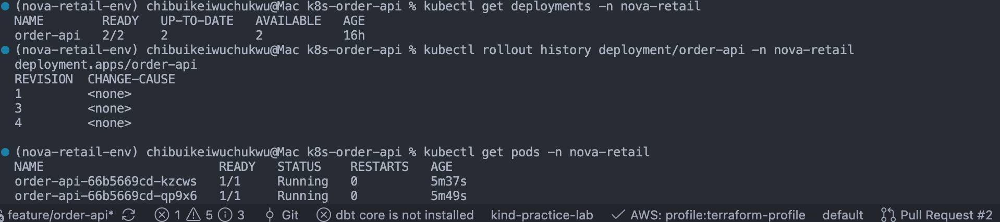

## Service Discovery

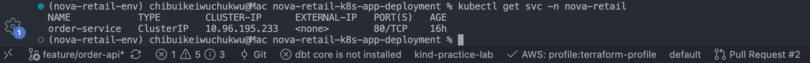

## Service endpointslices

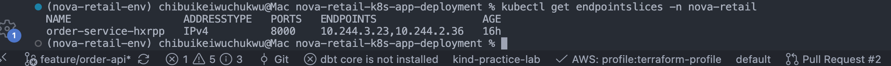

## Rolling Update Test

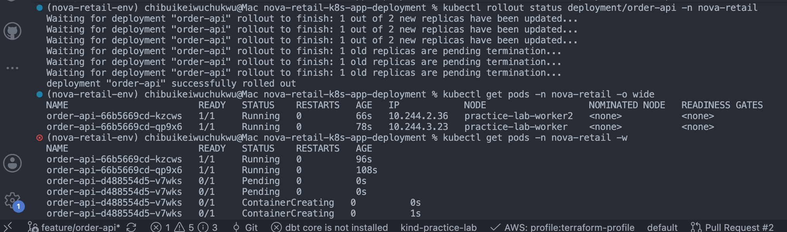

## Troubleshooting

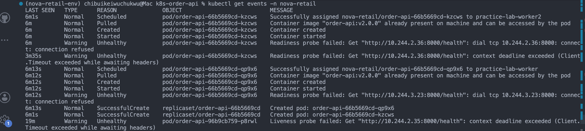

# Business case 2:

* Users should access the application through an HTTP endpoint.
* Some application data needs persistent storage.
* The application should automatically scale when demand increases.
* Containers should operate with safer security settings.
* The application should survive common infrastructure failures.
* Workloads should be distributed across worker nodes where possible.

## Storage Architecture Limitation

This deployment uses multiple API replicas (`replicas: 2`) together with a `ReadWriteOnce` PVC.

`ReadWriteOnce` storage is generally intended to be mounted read/write by workloads on a single node, so multiple replicas scheduled across different nodes should not rely on the same PVC for shared application data.

For a production Order API, the application should remain stateless and store persistent business data in an external database or shared storage service instead of depending on a single RWO filesystem shared between replicas.

## Metrics server

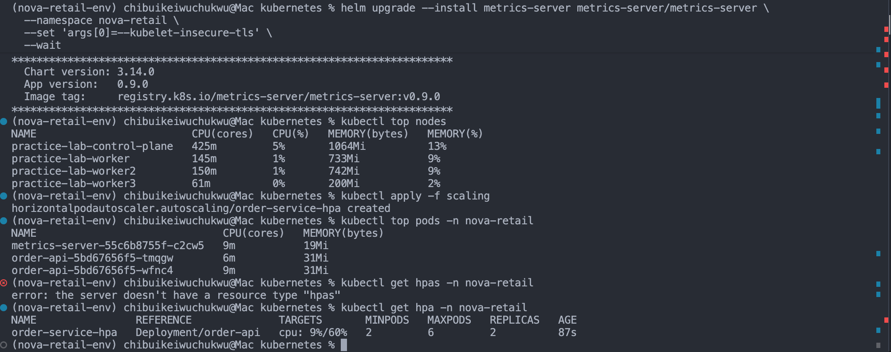

## Application scaling with HPA

Implemented Horizontal Pod Autoscaling using CPU utilization, maintaining two baseline replicas while allowing the Order API to scale to six replicas during increased demand.

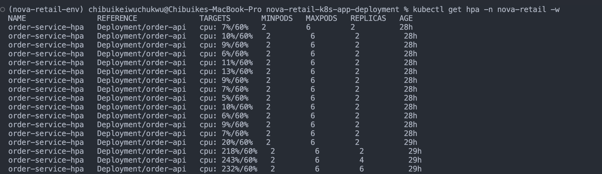

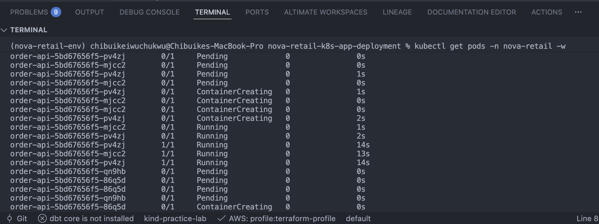

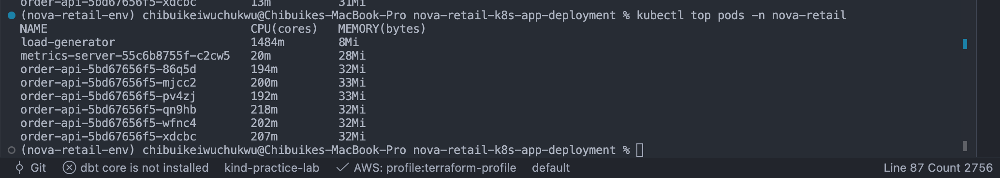

## Intentional Pods scheduling outcome

### Without Pod Anti-affinity

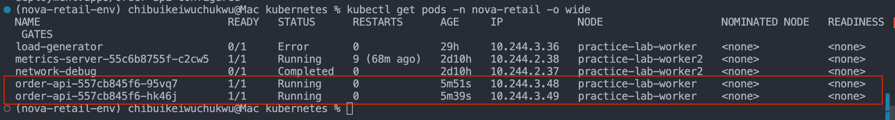

### With Pod Anti-affinity - 

* Introduced Pod distribution preferences across Kubernetes worker nodes and simulated node maintenance using cordon and drain operations to validate workload rescheduling.

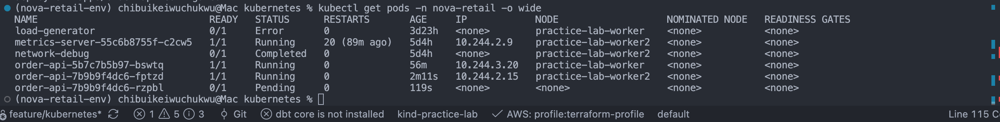

* NB: Change in pod identity is as a result of the fact that we are dealing with stateless workload - in this case deployment workload

### Investigating while pod 'order-api-5896946cb8-4whlf' - still had a 'pending' status

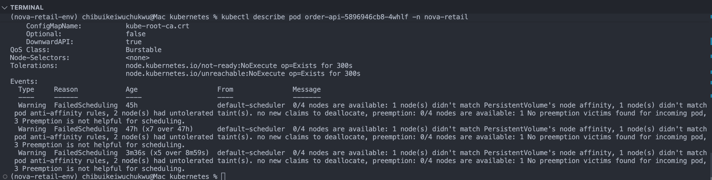

## Tainted nodes -  to ensure only designated pods are permissible

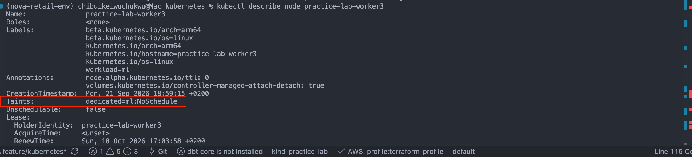

## To improve container runtime safety and compliance - I added security context

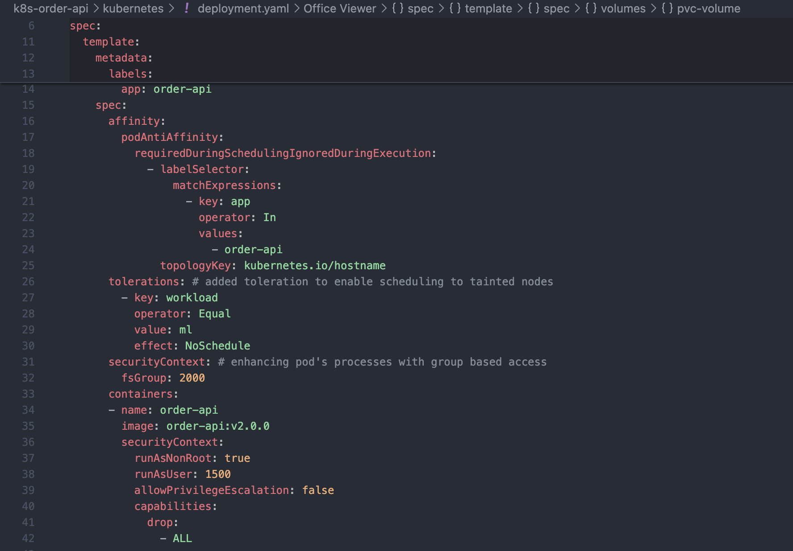

## Business case 3

* Transform the existing Kubernetes Order API into a secure, maintainable, multi-environment platform using Helm, Kustomize, RBAC, NetworkPolicies, Pod Disruption Budgets, TLS, and controlled deployment strategies.

## Architecture

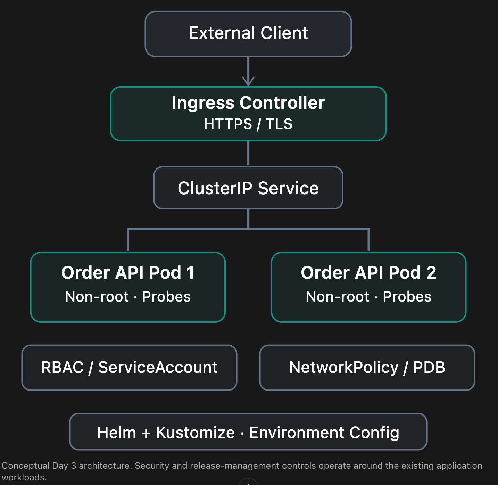

### Exiting resource and environment

* Existing multi-node kind cluster, Docker, kubectl, Helm, Python/FastAPI

### Expectations:

* Configuration drift: Development and production configurations are being maintained manually.
* Deployment inconsistency: Engineers apply multiple YAML manifests individually.
* Excessive permissions: Application identities and developer access have not been explicitly restricted.
* Unrestricted networking: Workloads can potentially communicate with services they do not need.
* Availability risks: Routine maintenance could disrupt too many replicas.
* Release risks: Application changes require a repeatable, controlled deployment process.
* Transport security: External application traffic requires HTTPS.
